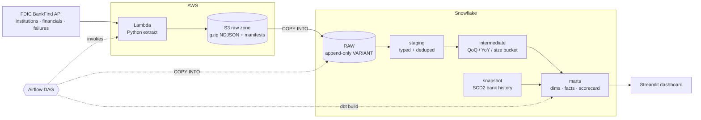

# FDIC Bank Health Pipeline

A daily ELT pipeline that pulls **real public data on every FDIC-insured U.S. bank**
(~4,300 active banks, ~27,800 institutions since 1934, ~4,100 failures) from the FDIC
BankFind API, lands it in **S3**, loads it into **Snowflake**, and models it with **dbt**
into a bank health scorecard. **Airflow** orchestrates it, **Terraform** provisions it,
and **GitHub Actions** tests it.



## What it produces

| Model | Grain | What it's for |
|---|---|---|
| `dim_bank` | bank | Current attributes: name, charter, regulator, holding company, failure history |
| `dim_bank_history` | bank × version | SCD type 2: renames, acquisitions, charter changes over time |
| `dim_quarter` | quarter | Calendar quarter-ends (call report dates) |
| `fct_bank_quarterly_financials` | bank × quarter | Balance sheet, income, regulatory ratios, growth (incremental merge) |
| `fct_bank_failures` | failure | Every failure / assistance transaction since 1934 |
| `bank_health_scorecard` | bank × quarter | CAMELS-style risk flags + 0-100 peer-percentile score + tier |
| `industry_quarterly_trends` | quarter | Industry totals, medians, tier mix, failures |

**The scorecard** combines two layers:

1. **Fixed-threshold risk flags** you can explain in one sentence: tier 1 leverage < 5%
   (the "well capitalized" line), noncurrent loans > 3%, net charge-offs > 1%, negative ROA,
   loans/deposits > 100%, uninsured deposits > 50% of deposits (the SVB failure mode).
2. **A composite score**: the bank's percentile rank among peers *of the same size in the
   same quarter*, averaged across capital, asset quality, earnings, liquidity and funding.
   Percentiles hold up against the extreme ratios tiny banks report (ROA of -53%, efficiency
   ratio of -700%).

Tiers: **High Risk** (3+ flags, or 2 flags with score < 25), **Watch** (any flag, or
score < 20), **Strong** (score ≥ 65), otherwise **Satisfactory**. A relative score alone
can't make a bank High Risk. That takes absolute red flags. This is an analytical view of
public data, not a regulatory CAMELS rating.

**Calibrated on real data (Q2 2026, 4,313 banks):** 27 High Risk, 965 Watch,
2,164 Satisfactory, 1,157 Strong. My first rules put any bank in the bottom 40% of its
peers on Watch, even with zero flags. First Citizens, for example, was flagged only because
the over-$100B peer group has 32 banks. I tightened the rules so Watch needs an absolute
flag or a bottom-fifth score. JPMorgan still lands on Watch, for a real reason: about 61% of
its domestic deposits are uninsured. The High Risk list also shows the limits of size-only
peer groups. Card banks (high charge-offs) and captive lenders (little deposit funding)
trip flags by design, which motivates peer groups by business model (see Extensions).

### What the first production run caught

The first `dbt build` on Snowflake (257,720 financials rows, Q1 2015 to Q2 2026) failed
three ways. Each was fixed at the root, not by deleting a test:

| Finding | Root cause | Fix |
|---|---|---|
| SQL compilation error | Snowflake doesn't support named `WINDOW` clauses | Inline each `OVER (...)` |
| 2,484 financials rows with no matching bank | 81 **non-insured trust companies** (e.g. Computershare Trust Co.) file call reports but are absent from the FDIC `/institutions` endpoint. The API itself returns nothing for them | Pull name/city/state/charter with each filing; add them to `dim_bank` as **inferred members** (`is_inferred_member`); score insured banks only |
| 80 bank-quarters with deposits > assets | Real: 22 small banks with **negative equity** (deposits up to 7.7% above assets) | Rewrote the test to catch what it's for (a $ vs $000s mix-up), not real insolvency |

Final run: **PASS=76, WARN=3, ERROR=0**. The 3 warnings are known, documented outliers.
The failures mart lines up with history: 2 failures in 2023-Q1 (Silicon Valley Bank and
Signature) and 1 in 2023-Q2 (First Republic).

## Design decisions (and why)

**Extraction**
- **Standard library only** in the Lambda (`urllib`), so the deployment package is just the
  source files. No layers, no dependency CVEs to patch.
- **Explicit field lists** per endpoint. Smaller payloads, and if the FDIC renames a field
  the dbt `not_null` tests fail loudly instead of silently loading nulls.
- **Retries with exponential backoff** on 429/5xx and network errors; fails fast on 4xx.
- **Reconciliation manifests.** Every file gets a `_manifest.json` with records written
  vs. the total the API reported. The Lambda raises on a mismatch, and Airflow checks again.
- **Re-pulls the last 4 quarters daily.** Banks amend call reports after filing, so
  downstream dedup keeps the latest version. An unpublished quarter returns 0 rows and
  writes only a manifest.

**Storage and loading**
- S3 layout `raw/fdic/<endpoint>/[report_date=…/]ingest_date=…/<run_id>.ndjson.gz`, so any
  day or quarter can be reloaded on its own.
- **Raw is untouched and append-only** (`VARIANT` + lineage columns: run ID, source file,
  row number, load time). Every transformation can be rebuilt from raw.
- **`COPY INTO` is idempotent**: Snowflake's load history skips files already loaded, so
  re-running a failed DAG never duplicates data.
- **No AWS keys in Snowflake**: a storage integration assumes an IAM role locked to
  Snowflake's IAM user and external ID.

**Modeling (dbt)**
- **Staging** types every field, converts $000s to dollars, parses the FDIC's `M/D/YYYY`
  dates, turns the `12/31/9999` sentinel into null, and dedupes with `QUALIFY ROW_NUMBER()`.
- **Failures key on the FDIC failure ID, not CERT.** Profiling the live data showed 488
  failures have no CERT and 45 CERTs repeat.
- **Growth metrics check that the prior row really is the prior quarter** before computing
  QoQ/YoY, so a bank with a filing gap doesn't get a bogus number. Quarterly net income is
  derived from year-to-date figures (Q1 = YTD; later quarters = YTD − prior YTD).
- **Kimball star schema** with surrogate keys, an **incremental merge** fact
  (`unique_key = [cert, report_date]`, reprocessing the last N quarters), and an **SCD2
  snapshot** for bank attributes.
- **Environment-aware schemas**: prod writes to `staging` / `marts`; dev and CI write to
  `dbt_<you>_marts`, so nobody overwrites production.

**Data quality: 64 dbt tests plus controls**

| Control | Where |
|---|---|
| Record count = API total (per file) | Lambda + Airflow `invoke_extract` |
| Source freshness (warn 30h, error 54h) | `dbt source freshness`, gates the build |
| Unique / not-null keys, grain uniqueness | every model |
| Referential integrity (fact → dims) | `relationships` tests |
| Domain checks (regulator, tier, size bucket) | `accepted_values` |
| Range checks (ratios, scores, flag counts) | `dbt_utils.accepted_range` |
| Every report date is a quarter-end | custom generic test `is_quarter_end` |
| Raw (bank, quarter) count = staging count | `assert_raw_financials_reconcile_to_staging` |
| Deposits ≤ assets (catches $ vs $000s mix-ups) | `assert_deposits_not_greater_than_assets` |
| Latest quarter not >5% short of the prior one | `assert_latest_quarter_complete` (warn) |

Failing rows are stored in a `test_failures` schema (`store_failures: true`) for triage.
Checks that real-world outliers would trip (tiny banks with 277% leverage ratios) use
`severity: warn` so they surface without blocking the pipeline.

**Orchestration (Airflow)**
- **Dynamic task mapping**: `plan_extracts` decides the calls and `invoke_extract.expand()`
  runs them in parallel (capped at 4).
- **Backfill as a parameter**: trigger with `{"backfill_start_year": 2010}` and financials
  split into 8-quarter chunks, each its own Lambda call under the 15-minute limit.
- `dbt build` runs snapshot, models and tests in dependency order, so a failing test stops
  bad data from reaching the marts.
- Retries with exponential backoff, `max_active_runs=1`, a run timeout, and failure alerts
  to SNS (email/Slack). A CloudWatch alarm also fires on any Lambda error.

**Security**
- Least-privilege IAM: the Lambda can only `PutObject` under `raw/fdic/*`; Snowflake can
  only read it; Airflow can only invoke the one function.
- S3: encryption at rest, versioning, public access blocked, TLS required, and lifecycle
  tiering (Standard → IA at 30 days → Glacier IR at 180).
- Snowflake: separate loader / transformer / reporter roles; service user with key-pair auth.

## Repository layout

```
ingestion/            Python extract package (Lambda + local CLI) and pytest suite
  fdic_pipeline/        client.py · extract.py · writer.py · quarters.py · lambda_handler.py · cli.py
snowflake/            01 setup · 02 storage integration · 03 raw objects · 04 COPY INTO
dbt/                  staging → intermediate → marts, snapshot, seed, macros, tests
airflow/dags/         fdic_bank_health_daily.py + sql/copy_into_raw.sql
infra/terraform/      S3, Lambda, IAM, SNS, CloudWatch alarm
dashboard/            Streamlit app (local or Streamlit in Snowflake)
.github/workflows/    CI: ruff + pytest, dbt parse, optional Slim CI dbt build, terraform validate
```

## Run it

### 0. Try the extractor locally (no cloud account needed)

```bash
cd ingestion
pip install pytest && pytest -q
python -m fdic_pipeline.cli extract institutions --local-dir ../data
python -m fdic_pipeline.cli extract financials --lookback-quarters 2 --local-dir ../data
python -m fdic_pipeline.cli extract failures --local-dir ../data
```

On Windows, keep the project in a short path (e.g. `C:\code\fdic`). The nested
partition folders can pass the 260-character path limit.

### 1. AWS (free tier is enough)

```bash
cd infra/terraform
cp terraform.tfvars.example terraform.tfvars   # set a unique raw_bucket_name
terraform init && terraform apply
```

### 2. Snowflake (30-day free trial works)

Run `snowflake/01_setup.sql`, then `02_storage_integration.sql` with the
`snowflake_role_arn` and `raw_stage_url` Terraform outputs. Copy `STORAGE_AWS_IAM_USER_ARN`
and `STORAGE_AWS_EXTERNAL_ID` from `DESC INTEGRATION` into `terraform.tfvars` and
`terraform apply` again to lock the trust policy. Then run `03_raw_objects.sql`.

### 3. First load

```bash
aws lambda invoke --function-name fdic-extract --payload '{"endpoint":"institutions"}' --cli-binary-format raw-in-base64-out out.json
python -m fdic_pipeline.cli backfill --start-year 2015 --bucket <raw_bucket>   # history, from your machine
```

Then run `snowflake/04_copy_into.sql`.

### 4. dbt

```bash
cd dbt
pip install "dbt-core>=1.9,<2" "dbt-snowflake>=1.9,<2"
cp profiles.yml.example ~/.dbt/profiles.yml   # set SNOWFLAKE_* env vars
dbt deps && dbt build                          # dev target → dbt_<you>_* schemas
dbt docs generate && dbt docs serve            # lineage graph + column docs
```

### 5. Airflow

`airflow/` is an [Astro CLI](https://www.astronomer.io/docs/astro/cli/overview) project
(Airflow 3 on Astro Runtime 3.3). Requires Docker Desktop.

```bash
cd airflow
cp .env.example .env     # fill in host paths + Snowflake account (no quotes)
astro dev start          # UI at http://localhost:8080
```

How it's wired:
- **dbt runs in its own virtualenv** inside the image (`Dockerfile`), because its
  dependencies conflict with Airflow's. The DAG calls it via `FDIC_DBT_BIN`.
- **No secrets in the image.** `docker-compose.override.yml` mounts the dbt project, the
  Snowflake private key and your AWS CLI profile read-only at runtime.
- **Connections and Variables come from `.env`** (`AIRFLOW_CONN_*`, `AIRFLOW_VAR_*`), so
  there's nothing to click through in the UI.
- The DAG imports work on both Airflow 2.x and 3.x.

### 6. Dashboard

```bash
cd dashboard && pip install -r requirements.txt && streamlit run streamlit_app.py
```

Or paste `streamlit_app.py` into **Streamlit in Snowflake**, where no credentials are needed.

## Cost

Within free tiers, apart from Snowflake compute: an X-Small warehouse with 60-second
auto-suspend runs a few minutes a day (a fraction of a credit). Lambda, S3 and SNS usage
here stays inside AWS's always-free limits.

## Extensions worth discussing

- **Snowpipe** (S3 event → SQS → auto-ingest) instead of scheduled `COPY INTO`
- **Data Vault** raw layer (hubs: bank; links: bank-holding company; satellites: financials)
- **FRED** interest-rate series joined in to relate NIM compression to the Fed funds rate
- **Great Expectations / Elementary** for anomaly detection on metric drift
- **Peer groups by business model** (FDIC specialization) instead of asset size only
